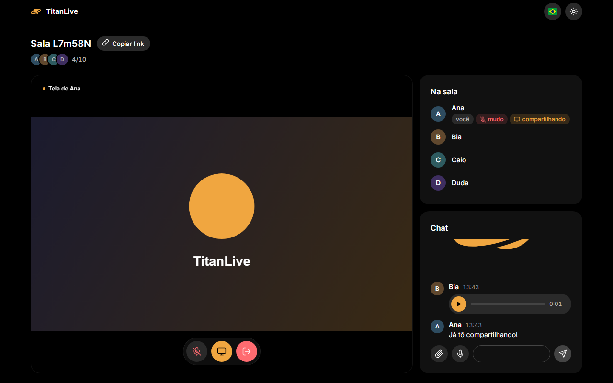
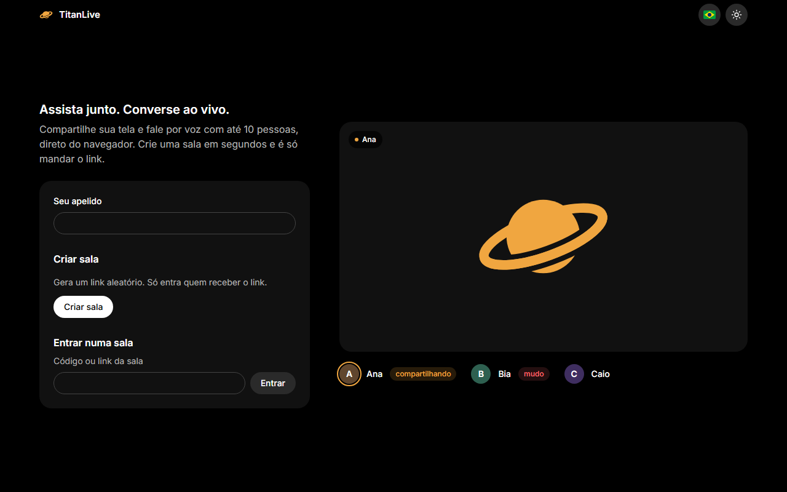
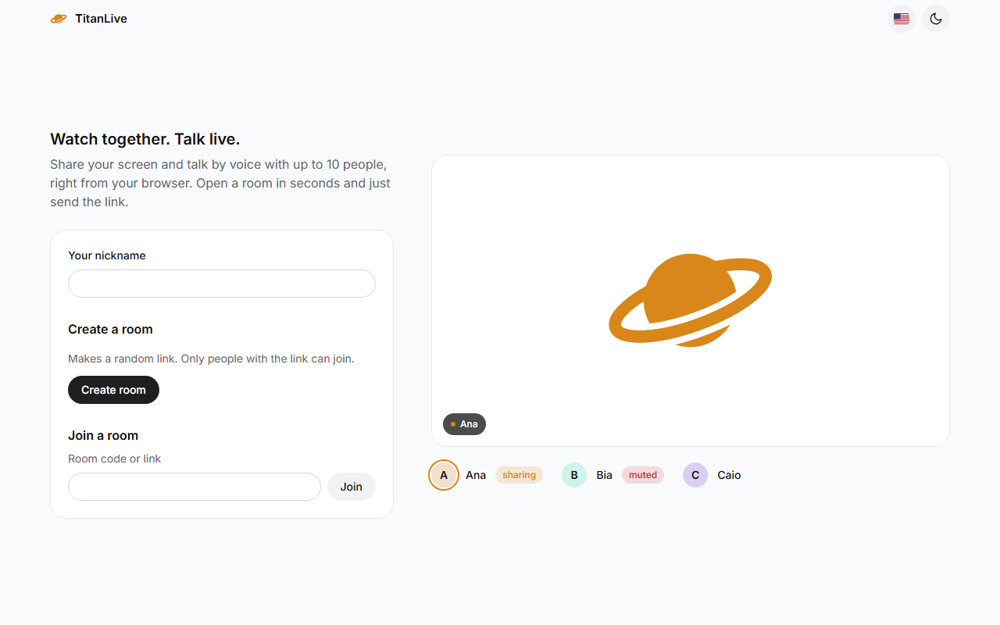
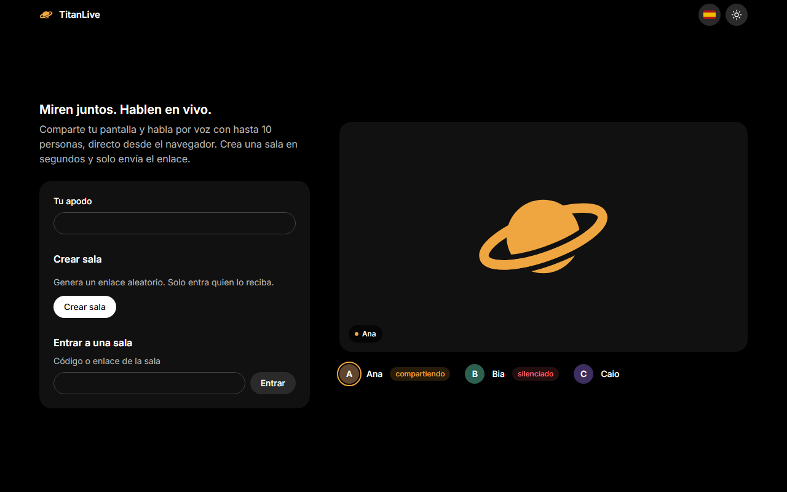

<p align="center">
  
</p>

<h1 align="center">TitanLive</h1>

<p align="center">
  <a href="README.md">English</a> · <b>Português (Brasil)</b> · <a href="README.es.md">Español</a>
</p>

<p align="center">
  Assista junto e converse ao vivo: compartilhe sua tela e fale por voz com até 10 pessoas, direto do navegador. Sem cadastro, sem instalar nada, é só mandar o link.
</p>

<p align="center">
  
  
  
  
  
  
</p>

<p align="center">
  
</p>

> [!NOTE]
> **Nada é guardado.** As salas existem só na memória do servidor. Mensagens e arquivos do chat são repassados para quem está na sala e somem quando você sai. Áudio e vídeo vão direto entre as pessoas via WebRTC.

## Recursos

- **Sala em um clique**: um link aleatório é a chave. Só entra quem recebe o link, até 10 pessoas por sala.
- **Compartilhamento de tela**: uma pessoa compartilha e todo mundo assiste no palco.
- **Câmeras**: ligue a sua e todo mundo aparece em blocos. Eles ocupam o palco ou ficam em fila ao lado da tela compartilhada.
- **Reações**: 👍 😂 ❤️ 👏 🎉 😮 sobem pelo palco com o nome de quem mandou.
- **Voz**: liga e desliga o microfone num botão, e um anel dourado mostra quem está falando. Entrou sem microfone? Ative depois. A redução de ruído vem ligada.
- **Chat com mídia**: texto, imagens, vídeos e arquivos de áudio (até 8 MB cada), e mensagens de voz gravadas direto no chat.
- **Controles num lugar só**: microfone, compartilhar tela e sair ficam juntos numa barra sobre o palco, e o copiar link fica ao lado do nome da sala.
- **Quem está na sala**: os avatares de todo mundo ao lado do contador e cápsulas de status para *você*, *mudo* e *compartilhando*.
- **Reconecta sozinho** quando a conexão cai.
- **Configurações** (⚙): tema claro ou escuro, Português, English ou Español, e redução de ruído (desligue para tocar música). Tudo fica salvo.
- **Pronto para TURN**: um `docker-compose.yml` com coturn para quem está atrás de NAT restritivo.

## Telas

**Início**: crie uma sala ou cole um link.

<p align="center"></p>

**Tema claro** e **Español**:

<p align="center">
  
  
</p>

## Como rodar

Você precisa do [Node.js](https://nodejs.org) **20.19 ou mais novo**.

```sh
git clone https://github.com/SamuelSchutz13/TitanLive.git
cd TitanLive

cd server && npm install && npm run start:dev   # http://localhost:3000
cd ../web && npm install && npm run dev         # http://localhost:5173
```

Abra http://localhost:5173, escolha um apelido e crie uma sala.

### Configuração

`server/.env` (copie de `server/.env.example`):

| Variável                      | Descrição                                                           |
| ----------------------------- | ------------------------------------------------------------------- |
| `PORT`                        | Porta do servidor (padrão `3000`)                                   |
| `WEB_ORIGIN`                  | Origem permitida para o site (padrão: qualquer)                     |
| `TURN_URLS`, `TURN_SECRET`    | Relay TURN (coturn `use-auth-secret`). Vazio = só STUN              |
| `OTEL_*`                      | Exportação OpenTelemetry no `npm run start:prod` (SigNoz ou OTLP)   |

`web/.env`: `VITE_SERVER_URL` (padrão `http://localhost:3000`).

TURN para redes restritivas:

```sh
TURN_SECRET=troque-isto docker compose up -d   # em produção, defina TURN_EXTERNAL_IP com o IP público
```

### Scripts

| Onde      | Comando              | O que faz                                          |
| --------- | -------------------- | -------------------------------------------------- |
| `server/` | `npm run start:dev`  | Servidor com reload na porta 3000                  |
| `server/` | `npm run test:e2e`   | Jest: salas, sinalização, chat e arquivos          |
| `server/` | `npm run start:prod` | Servidor compilado com OpenTelemetry               |
| `web/`    | `npm run dev`        | Vite com hot reload                                |
| `web/`    | `npm run build`      | Checa os tipos e gera `web/dist`                   |
| `web/`    | `npm run test:e2e`   | Playwright: navegadores reais entrando em salas    |

## Privacidade e segurança

- **Sem conta e sem histórico.** As salas só existem na memória enquanto tem alguém nelas.
- **Privada pelo link.** O código da sala tem 96 bits aleatórios, gerados no navegador.
- **Mídia direto entre as pessoas.** O servidor só repassa a sinalização WebRTC entre quem está na mesma sala.
- **Arquivos validados e nunca salvos.** Só `image/*`, `video/*` e `audio/*` de até 8 MB, repassados sem armazenar.
- **Limites no servidor**: apelido até 32 caracteres, mensagens até 500, 5 mensagens a cada 5 segundos por pessoa, 10 pessoas por sala.
- **O TURN nunca repassa para redes privadas**: o coturn bloqueia faixas privadas e de loopback.

## Como funciona

```
navegador (Vite + TypeScript)  ⇄  Socket.IO  ⇄  NestJS (sinalização, chat)
        ⇅ WebRTC (tela + voz, direto entre as pessoas, TURN quando precisa)
navegador  ⇄  navegador
```

Os eventos Socket.IO e os erros estão em [server/README.md](server/README.md), e o Swagger fica em `http://localhost:3000/docs`.
